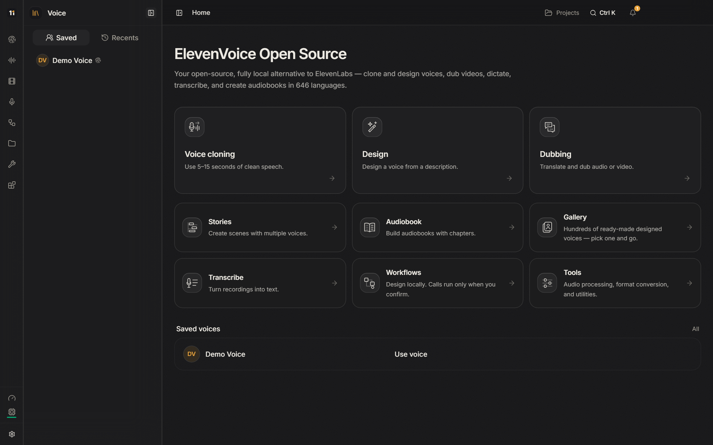
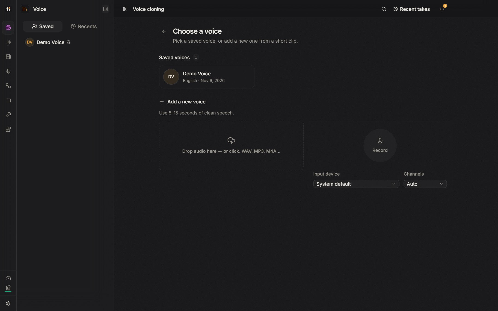
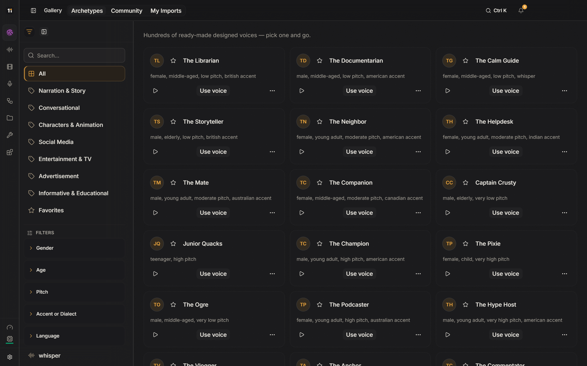
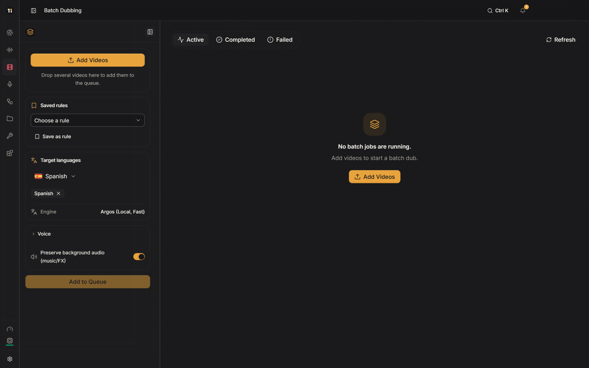
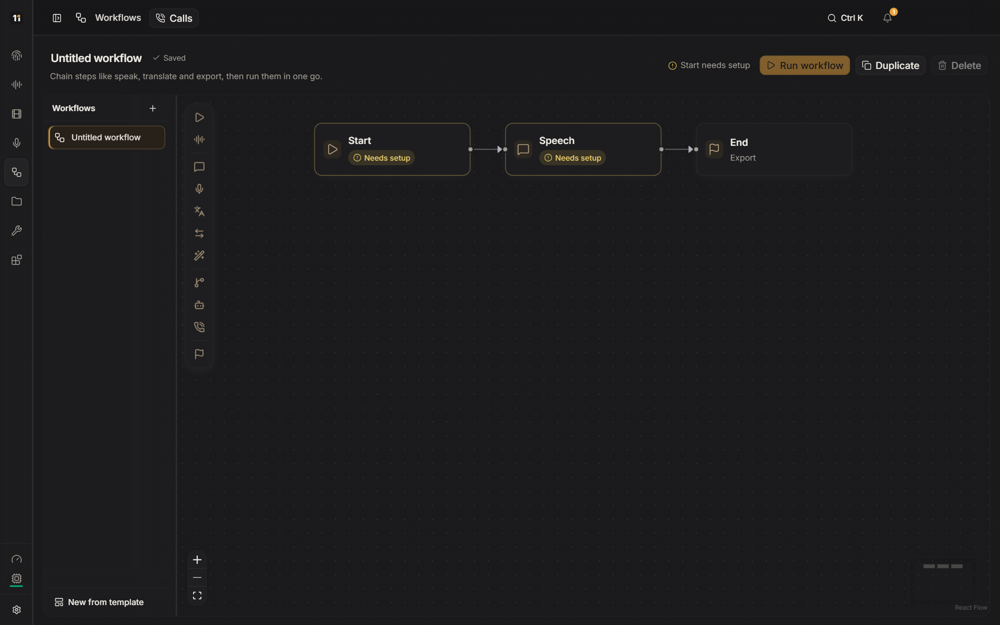

<div align="center">


# ElevenVoice

### Fuck-off ElevenLabs, and Pay Services.

**The free, open-source, fully local AI voice studio.**
Clone and design voices, dub videos, transcribe, dictate and narrate audiobooks in 646 languages.
No account. No subscription. No credits. Your voice never leaves your computer.

<p>
  <a href="https://github.com/Hylanderry/ElevenVoice/stargazers"></a>
  <a href="LICENSE"></a>
  
  
  
  <a href="https://github.com/Hylanderry/ElevenVoice/commits/main"></a>
</p>

<p>
  <a href="#install"><b>Install</b></a> ·
  <a href="#what-you-can-do"><b>Features</b></a> ·
  <a href="#local-api"><b>API</b></a> ·
  <a href="https://github.com/Hylanderry/ElevenVoice/issues"><b>Report a bug</b></a>
</p>



</div>

## Why ElevenVoice

- **Everything stays on your machine.** Your voices, recordings and projects never leave your computer. Nothing is uploaded unless you choose an online provider yourself.
- **Every feature is free.** No plans, no credits, no paywall, no sign-in.
- **It uses the hardware you have.** NVIDIA (CUDA), AMD (ROCm), Apple Silicon or plain CPU are detected automatically. Heavy engines need a GPU with enough memory (about 6 GB for the default voice engine); lighter engines run on any computer.
- **It knows what you already have.** Setup checks your system, finds ffmpeg and any models you already downloaded, and only fetches what is missing.

## What you can do

| | |
|---|---|
| **Voice cloning** | Turn 5 to 15 seconds of clean speech into a voice you can reuse. |
| **Voice design** | Describe a voice in words ("calm older narrator, British accent") and generate it. |
| **Video dubbing** | Transcribe, translate and dub audio or video, with speech timed to the original. |
| **Stories and audiobooks** | Write scenes with several voices, or build a full audiobook with chapters. |
| **Transcription and dictation** | Turn recordings into text, or dictate into any app with a shortcut. |
| **Gallery** | Hundreds of ready-made voices to start from. |
| **Workflows** | Chain steps (transcribe, translate, speak, export) and run them on whole folders. |
| **Audio tools** | Speed, format conversion, voice comparison and other utilities. |

### Production tools, free

| | |
|---|---|
| **Version review** | Approve the take you sign off on, keep a revision note on each take, and compare two takes side by side. Approved takes are never cleaned up automatically. |
| **Batch rules and reports** | Save target languages, voice and background as a named rule and reuse it in one click. Watch a folder to dub new videos as they arrive, and export a CSV report of every job. |
| **Pre-delivery check** | Before handing a dubbing project over, see what is missing: untranslated lines, missing tracks, silent or clipping audio, tracks longer than the source. |
| **Client delivery package** | One zip per project with the dubbed audio, SRT and VTT subtitles and the timed script for every language, plus the check report. |

<table>
  <tr>
    <td width="50%"></td>
    <td width="50%"></td>
  </tr>
  <tr>
    <td align="center"><sub>Voice cloning</sub></td>
    <td align="center"><sub>Voice gallery</sub></td>
  </tr>
  <tr>
    <td width="50%"></td>
    <td width="50%"></td>
  </tr>
  <tr>
    <td align="center"><sub>Batch dubbing with saved rules</sub></td>
    <td align="center"><sub>Workflows</sub></td>
  </tr>
</table>

## ElevenVoice vs. paid voice services

| | **ElevenVoice** | Typical paid service |
|---|---|---|
| Price | **$0, forever** | Monthly plan + credits |
| Account | **None** | Required |
| Where your audio goes | **Stays on your computer** | Uploaded to their servers |
| Usage limits | **Only your hardware** | Characters per month |
| Works offline | **Yes** | No |
| Source code | **Open (AGPL-3.0)** | Closed |
| Local API and MCP server | **Included** | Paid tiers |

## Install

### One command

**Windows** (PowerShell):

```powershell
irm https://raw.githubusercontent.com/Hylanderry/ElevenVoice/main/install.ps1 | iex
```

**macOS (Apple Silicon) and Linux:**

```bash
curl -fsSL https://raw.githubusercontent.com/Hylanderry/ElevenVoice/main/install.sh | sh
```

The installer downloads ElevenVoice to `~/ElevenVoice`, installs [Bun](https://bun.sh) and [uv](https://docs.astral.sh/uv/) if you don't have them, sets up the voice engine for your GPU and opens the app. The first launch walks you through choosing models; nothing large is downloaded without your OK.

### Manually

You need [Git](https://git-scm.com), [Bun](https://bun.sh) and [uv](https://docs.astral.sh/uv/).

```bash
git clone https://github.com/Hylanderry/ElevenVoice.git
cd ElevenVoice
bun install
bun run setup:api
bun run desktop
```

| Command | What it does |
|---|---|
| `bun run desktop` | Opens the desktop app. |
| `bun run dev:web` | Runs the app in your browser at `http://localhost:3901`. |
| `bun run setup:api` | Reinstalls the Python voice engine (use it after updating). |
| `bun run dist` | Builds an installer for your system. |

### Requirements

- Windows 10/11 x64, macOS on Apple Silicon, or a recent 64-bit Linux.
- 16 GB of RAM recommended, and 10 GB or more of free disk space for models.
- A GPU is optional. With 4 GB of VRAM or less, pick the lighter engines in Settings → Models.

## Local API

ElevenVoice includes a REST API so you can use it from scripts and other tools. With the app open:

- Interactive reference: open **Settings → ElevenVoice API** in the app, or `http://localhost:3900/docs`
- OpenAPI spec: `http://localhost:3900/openapi.json`

```bash
curl http://localhost:3900/health
```

There is also an MCP server, plus ready-made setups for n8n, OpenAI Agents, Claude Code, Cursor and Twilio under **Integrations**.

## Online providers (optional)

Everything works offline. If you want them, you can add your own keys under **Settings → Credentials**:

- **Hugging Face token** for gated models. It is stored encrypted on your computer.
- **Translation providers:** Google Cloud, DeepL, Microsoft Azure and AWS.

## Updating

```bash
cd ~/ElevenVoice
git pull
bun install
bun run setup:api
```

Running the one-command installer again does the same thing.

## Star history

If ElevenVoice saves you a subscription, a ⭐ helps other people find it.

<a href="https://star-history.com/#Hylanderry/ElevenVoice&Date">
  
</a>

## Creator

<table>
  <tr>
    <td><a href="https://github.com/Hylanderry"></a></td>
    <td>
      <b>Hylander</b> · <a href="https://github.com/Hylanderry">@Hylanderry</a><br />
      Creator and maintainer of ElevenVoice.<br />
      If it's useful to you, <a href="https://github.com/Hylanderry/ElevenVoice/stargazers">give it a ⭐ on GitHub</a>. It helps other people find it.
    </td>
  </tr>
</table>

## Contributing

Bug reports and ideas are welcome in [Issues](https://github.com/Hylanderry/ElevenVoice/issues). For pull requests, run the checks first:

```bash
bun run typecheck
bun run test
uv run pytest tests backend/tests
```

## License

ElevenVoice is free software under the [GNU AGPL-3.0](LICENSE). If you run a modified version for others over a network, you must share its source under the same license.

Voice models downloaded by the app keep their own licenses, and some do not allow commercial use. Check each model's notice in **Settings → Models**. Only clone voices you have permission to use.

<sub>Based on <a href="https://github.com/debpalash/VoiceStudio">VoiceStudio</a> (AGPL-3.0). See <a href="LICENSE-NOTICE.md">LICENSE-NOTICE.md</a>.</sub>
